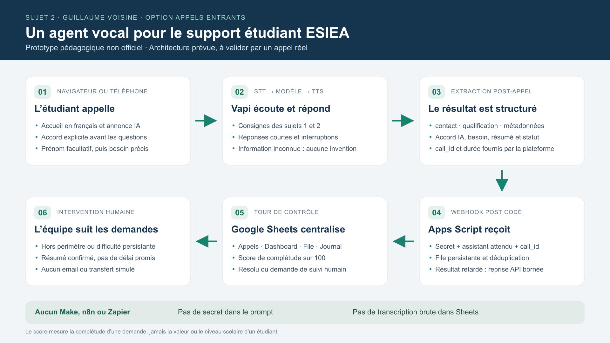

# Exercices ESIEA de Guillaume Voisine

Ce dépôt réunit les fichiers d'installation et la documentation des deux exercices de growth hacking. Il s'agit de prototypes pédagogiques, pas de services officiels de l'ESIEA.

| Exercice | Fichiers et installation | État |
|---|---|---|
| Sujet 1 — Veille de publications LinkedIn | [Ouvrir le dossier](sujet-1-veille-linkedin/) · [Guide d'installation](sujet-1-veille-linkedin/04_GUIDES_ET_VIDEOS.md) | Extension créée et chargée dans Chrome ; intégration complète encore à valider |
| Sujet 2 — Agent vocal entrant de support étudiant | [Ouvrir le dossier](sujet-2-agent-vocal/) · [Guide d'installation](sujet-2-agent-vocal/GUIDE_ET_RENDU.md) | Agent créé dans Vapi ; test vocal filmé par Guillaume ; connexion Sheets configurée ; réception fictive et extraction testées ; nouvel appel automatique à vérifier |

## Sujet 1

L'entreprise fictive CyberCap Formation sert de cas d'étude. Le dossier contient les réponses aux deux prompts, une extension Chrome, le script Google Apps Script, les consignes de réglage et les tests locaux.

- [Réponses aux deux prompts](sujet-1-veille-linkedin/01_REPONSES_AUX_DEUX_PROMPTS.md)
- [Extension Chrome à charger](sujet-1-veille-linkedin/extension/)
- [Script du tableur de veille](sujet-1-veille-linkedin/google-apps-script/Code.gs)
- [Installation et utilisation](sujet-1-veille-linkedin/04_GUIDES_ET_VIDEOS.md)

L'outil ne contourne aucun CAPTCHA, n'ouvre pas les profils et ne clique pas sur « Plus ». La consigne sur le texte complet est ambiguë ; la documentation explique la limite. Les tests utilisent des données simulées et ne prouvent pas la compatibilité des sélecteurs avec toutes les interfaces LinkedIn.

## Sujet 2

L'agent Vapi répond en français à partir des consignes des deux sujets et propose un suivi humain lorsque la question dépasse son périmètre.

- [Prompt et base de connaissances](sujet-2-agent-vocal/PROMPT_AGENT.txt)
- [Script Apps Script](sujet-2-agent-vocal/Code.gs)
- [Sortie structurée à configurer dans Vapi](sujet-2-agent-vocal/EXTRACTION_VAPI.json)
- [Installation et architecture](sujet-2-agent-vocal/GUIDE_ET_RENDU.md)
- [Questions de test et démonstrations](sujet-2-agent-vocal/TESTS_ET_DEMONSTRATION.md)
- [Vidéo du test vocal communiquée dans le tableau de rendu](https://cap.so/s/efg2wk4nm6wcqtz)

La vidéo du test ne démontre pas à elle seule le trajet Vapi → Google Sheets. L'extraction, le webhook et le tableau de bord sont configurés. La réception HTTP a été vérifiée avec un exemple fictif et l’extraction avec un aperçu sur un appel réel. Un nouvel appel après activation reste nécessaire pour valider l’envoi automatique depuis Vapi. Aucun numéro n'a été acheté par cet outil, aucun appel sortant ni notification automatique n'est configuré.



## Télécharger et installer

Dans GitHub, choisir **Code → Download ZIP**, puis décompresser l'archive. Suivre le guide du sujet concerné. Les sous-dossiers contiennent les fichiers à copier dans Google Apps Script ou à charger dans Chrome.

Créer les tableurs et leurs projets Apps Script avec son propre compte Google. Un accès en modification à un fichier d'un autre compte n'en change pas le propriétaire. Les autorisations, secrets et déploiements ne sont pas transférés par le téléchargement de ce dépôt.

## Vérifications locales

Avec Node.js récent, depuis le dossier du sujet choisi :

```sh
node --test tests/test.mjs
```

Sujet 1 : 14 tests locaux réussis. Sujet 2 : 14 tests locaux réussis. Les rapports dans chaque dossier distinguent ces tests simulés des preuves à obtenir dans les comptes réellement utilisés.

## Configuration privée

Aucun mot de passe, cookie, jeton actif ou clé API n'est inclus. Ne pas ajouter de secrets au dépôt. Les exemples contiennent des valeurs factices. Les valeurs privées se configurent uniquement dans les propriétés du script ou les paramètres locaux de l'application.

Ce dépôt ne contient ni notes d'étudiants, ni transcriptions réelles, ni base de prospects ou d'appels.

