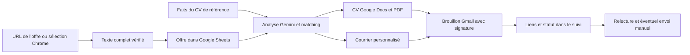

# Sujet 4 — Personnalisation des candidatures

Guillaume Voisine. Plateforme principale : Google Sheets. Collecte par URL publique SmartRecruiters, ou extension Chrome pour le texte sélectionné sur un autre site. Apps Script prépare l’analyse Gemini, un CV Google Docs exporté en PDF, un courrier et un brouillon Gmail avec PDF et signature illustrée. **Aucun envoi d’email n’est implémenté.**

## État réel

- Offre réelle choisie et vérifiée active le 18 novembre 2026 : [stage Consultant cybersécurité GRC chez CS, groupe Sopra Steria](https://jobs.smartrecruiters.com/SopraSteria1/744000159352249).
- CV de référence fourni par Guillaume, version française cybersécurité ATS. Les documents personnels sont dans `Prive_Guillaume/`, à conserver hors d’un dépôt public.
- Préparation locale : CV PDF d’une page contrôlé visuellement, courrier personnalisé, analyse, suivi de candidatures et fichier email EML avec PDF et visuel intégrés.
- Visuel de remerciement généré par IA. 14 tests locaux réussis sur services simulés.
- **Pas encore exécuté sur le compte Google Guillaume** : import natif du tableau, installation Apps Script, génération Gemini et création du brouillon Gmail. La connexion des applications Google disponible lors de la préparation est celle de Robin ; aucune donnée du CV n’y a été déposée.
- L’EML local est une préparation de message, pas la preuve d’un brouillon Gmail créé. L’analyse et le score locaux ont été préparés par l’assistant, pas par un appel du script Gemini.

## Installation sur le compte Guillaume

1. Connecter Google Drive et Gmail à **ton compte Google Guillaume**. Vérifier l’identité affichée avant d’importer les fichiers personnels.
2. Importer `Prive_Guillaume/Suivi_candidatures_Guillaume.xlsx` comme **Google Sheets natif**. Garder les quatre onglets et leurs en-têtes : OFFRES, PROFIL, CONFIG, LOGS.
3. Créer un dossier Drive privé pour le sujet 4 ; y déposer le CV de référence et `Signature_Merci_Guillaume.png`. Le nom du dossier seul ne suffit pas : relever son identifiant dans son URL et l’inscrire dans CONFIG → DOSSIER_ID. Reporter l’identifiant du PNG dans VISUEL_ID.
4. Dans le tableau → Extensions → Apps Script. Coller `Code.gs`, créer le fichier HTML `Collecte` à partir de `Collecte.html`. Afficher le manifeste dans les paramètres et remplacer son contenu par `appsscript.json`.
5. Paramètres du projet → Propriétés du script : renseigner **GEMINI_API_KEY**, jamais dans CONFIG, GitHub, le chat ou la vidéo. Une clé d’un projet gratuit avec quota disponible est nécessaire. Le modèle initial est `gemini-3.5-flash-lite`, testé dans le sujet 7 le 17 novembre, mais sa disponibilité doit être vérifiée pour ce projet.
6. Exécuter `installer` et accorder personnellement les accès Google demandés. Le manifeste limite Gmail à la composition des brouillons ; Google Docs et Drive servent à créer les documents et les PDF. Le code vérifie le compte Gmail attendu avant toute préparation.
7. Dans le projet Google Cloud associé, vérifier que **Gmail API** est activée si l’appel renvoie un refus de service désactivé. Ne pas activer de facturation pour cet exercice.
8. Recharger le tableau pour voir le menu **Candidatures**.

L’application ne nécessite aucun déploiement Web public, webhook, cookie, mot de passe ou jeton d’import. Les actions sont réservées au propriétaire via le tableau.

## Utilisation

Pour SmartRecruiters, choisir Candidatures → Ajouter une offre, coller l’URL et cliquer **Extraire l’offre publique**. Le script récupère les champs de l’API publique officielle. Relire le texte puis confirmer qu’il est complet avant l’ajout. Une offre fermée, inaccessible ou incomplète est refusée.

Pour un autre site, sélectionner le texte complet de l’annonce puis utiliser l’extension Chrome fournie : Lire ma sélection → Copier pour Google Sheets. Coller le JSON dans le panneau du tableau, cliquer Remplir les champs, vérifier la complétude puis ajouter. L’extension utilise uniquement activeTab, scripting et clipboardWrite. Elle n’effectue aucun envoi réseau et ne lit ni profils ni cookies. Le copier-coller est volontairement explicite ; la compatibilité de sélection dépend de la page affichée.

Dans OFFRES, sélectionner la ligne ajoutée puis Candidatures → Préparer la ligne sélectionnée. Ne pas trier ou déplacer les lignes pendant la préparation. Le traitement analyse l’offre, sélectionne et ordonne les faits du CV, calcule le score, crée les documents et prépare le brouillon. Les liens sont enregistrés dans le suivi.

Le destinataire reste vide lorsqu’aucune adresse n’est publiée dans l’offre. Le candidat peut saisir une adresse qu’il a vérifiée ; le script n’invente pas de recruteur et ne remplit pas le formulaire de candidature du portail employeur. Pour l’offre de démonstration, l’employeur propose une candidature via son portail : le brouillon email sert au rendu pédagogique, pas à remplacer ce canal.

Ouvrir le brouillon dans Gmail, relire le CV et le texte, vérifier l’image et la pièce jointe. Modifier librement. **Envoyer manuellement seulement si l’on souhaite réellement candidater et dispose d’un destinataire approprié.** Le menu Déclarer un envoi manuel actualise le statut après confirmation personnelle ; il n’envoie rien et ne prétend pas vérifier les messages envoyés.

## Personnalisation sans invention

PROFIL contient des faits exacts du CV de référence avec identifiants stables. Vérifier chaque ligne et sa colonne Validé. Gemini reçoit les faits professionnels et le texte de l’offre, **pas les coordonnées de CONFIG**. Éviter d’ajouter des coordonnées ou données sensibles dans les faits eux-mêmes.

Le modèle extrait des exigences avec des citations de l’offre et propose des IDs de preuves. Le code refuse les références inconnues et les exigences absentes de la source. Le CV et le courrier sont assemblés depuis les textes validés : la personnalisation porte sur le titre de candidature, la sélection et l’ordre des faits. Elle ne transforme pas une qualification en cours en diplôme obtenu. La lettre automatisée est volontairement structurée ; elle ne comporte pas de récit libre générant de nouvelles réalisations.

La relecture humaine reste nécessaire : un ID valide ne prouve pas à lui seul que l’IA a correctement jugé la correspondance sémantique. Le score demandé par l’exercice aide le candidat à comparer son propre CV à l’offre ; il n’automatise pas une décision de recrutement.

## Score et traçabilité

Pour chaque exigence : DIRECT = 1, PARTIEL = 0,5, ABSENT = 0. Le score est la moyenne multipliée par 100, arrondie. Les critères sont pondérés également. Une citation répétée est refusée. Le JSON conserve la catégorie, la citation, les preuves et le niveau ; les absences restent visibles.

L’exemple local donne **46/100**, sur 13 critères : 4 directs, 4 partiels, 5 absents. Ce résultat n’est pas une probabilité d’embauche. Il peut varier si le modèle choisit un autre découpage pertinent des exigences. ISO 27001 reste au niveau de notions ; ISO 27005, PASSI/LPM et homologation ne sont pas présentés comme maîtrisés.

Chaque offre a un ID et un hash URL+texte. Les reprises réutilisent les documents et l’analyse déjà enregistrés. Si le profil a changé, une reprise ne recycle pas l’ancienne analyse. Une tentative de création Gmail interrompue sans ID est bloquée jusqu’à vérification manuelle, afin d’éviter un second brouillon potentiellement identique. Un état EN_COURS après interruption doit également être contrôlé avant remise en A_PREPARER.

## Erreurs et limites

- URL non prise en charge : collecte par sélection, sans tentative de contourner une connexion ou un CAPTCHA.
- Erreur Gemini, quota ou réponse incomplète : statut ERREUR_A_REVOIR, code HTTP dans LOGS ; aucun faux succès ni boucle de relance.
- Modèle devenu indisponible : choisir un modèle textuel disponible dans le projet et tester à nouveau ; ne pas activer une offre payante par défaut.
- Limite de 15 appels IA/jour par défaut, plafond logiciel 30 ; traitement lancé à la demande, pas de déclencheur périodique.
- Création d’un document partiellement réussie : IDs conservés pour reprise ; ne pas supprimer manuellement ces IDs sans vérifier Drive/Gmail.
- Une interruption avant enregistrement d’un ID peut laisser un document isolé dans Drive. Le brouillon ambigu est bloqué pour inspection humaine.
- Les liens Gmail dépendent de l’interface du compte ; si le lien ne mène pas au bon brouillon, ouvrir Gmail → Brouillons et retrouver l’objet exact.
- Le CV Google Docs produit par le script doit être contrôlé visuellement après export. Le PDF local d’une page a une mise en page dédiée ; il n’est pas présenté comme un export déjà produit dans Google Docs.

## Confidentialité et dépôt

Ne publier que le code, l’extension, ce README, le schéma et le tutoriel. **Exclure `Prive_Guillaume/`, les CV, lettres, analyses personnelles, EML, captures de Gmail et clés API.** La préparation professionnelle contient des données personnelles : Drive reste privé. Partager les livrables au correcteur uniquement par un moyen approprié. Les documents et journaux ne sont pas purgés automatiquement ; supprimer les copies devenues inutiles, y compris les brouillons et exports, selon le besoin réel.

## Vérification

`node --test tests/test.mjs` : 14 tests simulés. Ils vérifient notamment sources, IDs, score, absence de faux faits, refus des URL arbitraires, neutralisation HTML/formules et MIME du message. Ils ne prouvent pas une autorisation Google, un appel Gemini ou un brouillon Gmail réel.

Avant de présenter le workflow comme fonctionnel de bout en bout : exécuter un appel Gemini depuis le tableau, vérifier le PDF réellement exporté, puis constater le brouillon Gmail contenant le bon PDF et la signature. La vidéo de 3 à 5 minutes doit montrer ces étapes réelles. Voir `TUTO_VIDEO_4_MIN.md`.

Documentation technique : [Gmail drafts.create](https://developers.google.com/workspace/gmail/api/reference/rest/v1/users.drafts/create), [Gmail drafts.get](https://developers.google.com/workspace/gmail/api/reference/rest/v1/users.drafts/get), [Apps Script DocumentApp](https://developers.google.com/apps-script/reference/document/document-app).
